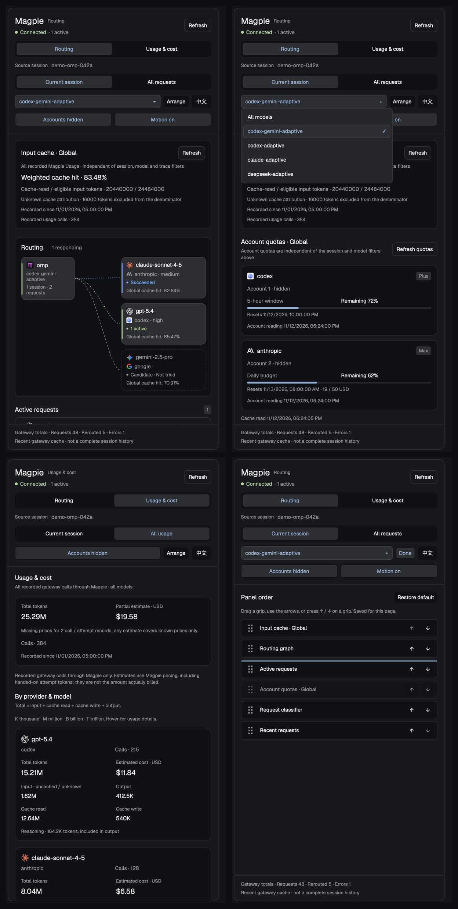

# Herdr Magpie Route

A native [Herdr](https://herdr.dev) sidebar for [Magpie](https://github.com/yetone/magpie) routing, model attempts and account quotas.

[简体中文](README.zh-CN.md) · [Rebuild recipe](RECIPE.md)



Native interface with illustrative demo data (synthetic session, metrics and masked accounts; no personal or live account data). Full-size captures: [Routing & cache](screenshots/routing.png) · [Group filter & quotas](screenshots/group-filter-quotas.png) · [Usage & cost](screenshots/usage-cost.png) · [Arrange panels](screenshots/arrange.png) · [Expanded classifier](screenshots/classifier.png).

## Features

- Follow the current local OMP session or inspect all retained gateway requests.
- See actual model destinations, effort, candidate branches and live native flow animation.
- Switch to a dedicated Usage & cost page for per-model input/output/cache tokens and USD estimates, scoped to the current session or all recorded gateway calls.
- Read overall and per-model input-cache hit rates, shown to two decimal places from all recorded Magpie Usage data.
- Expand the compact classifier section above recent requests to inspect model, intent, difficulty, confidence, latency and decision reuse.
- Inspect request attempts and routing details; preview three recent requests or expand into five-request pages.
- View global account quotas, remaining capacity, reset times and cached readings.
- Distinguish model-family icons from upstream-provider icons.
- Switch between English (default) and Simplified Chinese. The choice is remembered; notices, labels and date/number formatting follow the selected language.
- Hide account identities by default and turn animation off when preferred.

## Requirements

- Herdr App, verified with **0.1.15**, with native path painting and frame animation support. This is a Herdr mod, not an npm package or browser extension.
- A running local Magpie gateway exposing the trace, usage and quota APIs listed below. The earliest compatible Magpie release has not been established.
- For current-session binding: a local OMP process, Python 3, `hc` and `lsof`. The resolver uses Python's standard library.

macOS is the verified platform. Linux has not been validated; Windows session binding is not supported by the current Unix process/file discovery code. Global request browsing does not require successful OMP session binding.

## Install

Clone this repository, then copy the mod into your Herdr App home:

```sh
git clone https://github.com/SteinX/herdr-magpie-route.git
cd herdr-magpie-route
herdr_app_home="${HERDR_APP_HOME:-$HOME/.config/herdr-app}"
mkdir -p "$herdr_app_home/mods"
if test -e "$herdr_app_home/mods/magpie-route"; then
  printf '%s\n' 'magpie-route already exists; back it up before updating.'
else
  cp -R mods/magpie-route "$herdr_app_home/mods/"
fi
```

Keep the folder name `magpie-route`. Add this block beside the terminal block in a horizontal row of a **personal layout**:

```json
{
  "id": "magpie-route-panel",
  "type": "block",
  "content": { "mod": "magpie-route" },
  "size": { "px": 420 },
  "min": 340,
  "max": 680,
  "padding": 6
}
```

The row should allow resizing. The node ID must remain `magpie-route-panel` because the mod uses it to suspend work while hidden. Copying files alone does not dock the panel: its manifest uses `place: none`.

Clone a shipped layout before changing its structure; do not edit Herdr's shipped files. Keep `RECIPE.md`, `preview.png` and `screenshots/` in the repository, outside the installed mod folder.

Validate the installed mod:

```sh
herdr-app check "$herdr_app_home/mods/magpie-route"
```

These examples use the `herdr-app` CLI. If it is not on PATH, use the executable inside your installed Herdr.app with the same arguments. Herdr hot reloads personal mods; a restart is not required.

## Use

Choose a local OMP tab for **Current session**, or select **All requests** to browse the gateway's retained cache. Open the model filter dropdown to choose **All models** or any active routing group (such as `codex-gemini-adaptive` or `codex-adaptive`) directly. Scroll inside the menu when the list exceeds its height.

The **Routing / Usage & cost** tabs share the current-session/all scope selector and remember the chosen page. Connection status and **Refresh** stay visible in the same header positions on both pages, including while usage is loading. Usage & cost reads the persisted gateway-call ledger, refreshes every 30 seconds or on demand, and groups all models by provider/model. It is independent of the routing model filter. Total tokens are `input + output + cache_read + cache_write`; reasoning is already included in output. Handed-on attempts contribute tokens and cost without counting as another request. Token/call counts use decimal K/M/B/T units; summary, model and cache hover details use the same compact units.

Fees are estimates from Magpie's pricing, shown in compact USD amounts: normal amounts keep cents, sub-cent amounts retain four decimal places, and large amounts use K/M/B/T. They are not settled subscription or provider charges. Missing prices remain unavailable; a known-price subtotal is explicitly partial when other call/attempt records are unpriced. Current session requires an exact linked session and includes only records attributed to it. The ledger's broad search is narrowed by exact equality across every page; changing page totals abort the read rather than silently double-counting. All usage covers recorded calls through Magpie, excluding imported direct-call history and client-reported calls. A scope with no recorded calls shows no-data status rather than inferring zero charges; in-flight usage appears after it is recorded.

Choose **Arrange** to reorder the current page's sections using the dotted grips, then **Done** to return to the data. The insertion line marks the drop position; releasing saves, while Escape or leaving the list cancels the drag. Up/down buttons and grip arrow keys provide alternatives. Routing and Usage orders are saved separately across restarts; **Restore default** resets only the current page.

Click a request to expand its details and pin its route. Recent history starts with three rows; **Show all** enables five rows per page. Filtering resets the page. Global-history pagination survives changing the active terminal tab.

Input-cache statistics use `usage?period=all` and refresh every 30 seconds or on demand. They cover the recorded Magpie usage log, including client-reported and classifier calls, independently of session/model filters. Overall hit rate is token-weighted: `cache_read / (input + cache_read + cache_write - cache_unknown)`. The model cards use the same log grouped by provider/model across efforts and accounts. Unknown cache input is excluded; no eligible tokens or unavailable readings show “Not reported”. Rates retain two decimal places, including `0.00%` and `100.00%` when known.

The classifier section sits between account quotas and recent requests and starts collapsed. It shows the selected request's classifier, or the latest reported classification in the current routing scope when nothing is selected. Expand it for full metadata. Previous intent/effort are context, parent-group effort is inherited, and decision reuse is separate from input-token cache hits. Missing values remain unknown; raw classifier errors are not retained.

The language button shows **中文** in English and **EN** in Chinese. It changes only the mod's language. Account-identity visibility and motion are separate controls. All controls retain native keyboard focus behavior.

Quotas are global: changing session or model filters does not narrow the quota cards. Automatic reads use gateway cache; **Refresh quotas** explicitly asks the gateway to refresh provider readings. Unknown quota is never displayed as zero usage.

Native mod commands `magpie-route.refresh`, `magpie-route.locale`, `magpie-route.routing`, `magpie-route.usage`, `magpie-route.scope-session`, `magpie-route.scope-all`, `magpie-route.model-filter`, `magpie-route.arrange` and `magpie-route.order-reset` can be invoked with `herdr-app do` or assigned keys in your own `keys.json`. The model-filter command opens or closes the routing-group dropdown; the locale command toggles the saved language preference.

## Data access and privacy

The mod:

- Reads only the gateway port from `~/.config/magpie/settings.json`, defaulting to 3425.
- Uses loopback HTTP at `127.0.0.1:<port>/`: `GET v1/models`, `GET v1/magpie/trace?after=…`, `GET v1/magpie/usage?period=all`, `GET v1/magpie/usage/requests?period=all&via=through&limit=…&offset=…` (with `q` for session reads), `GET v1/magpie/quotas?kept=1`, and explicit `POST v1/magpie/quotas/refresh`.
- Runs `python3`, `hc get --json` and `lsof` to bind a local terminal's foreground OMP process to its uniquely open root session.
- Reads at most 16 KiB / four leading lines of candidate session files under `~/.omp/agent/sessions`; it does not scan full conversation history.
- Retains a narrowed set of routing fields rather than full trace prompt metadata. Account names are masked by default. Provider-supplied raw text keeps its original language.
- Reduces Usage responses immediately to aggregate/model counters and the recording start; session, account, key and file-path fields are discarded.
- Narrows accounting pages immediately to token/price counters, matching the linked session locally; raw ledger rows, account/key metadata and response IDs are not retained in view state.

The request list is the gateway's recent cache, not a complete session archive. No telemetry or external icon downloads occur at runtime. This repository contains no user settings, account credentials, session files or personal layouts. The preview images render the native panel with synthetic demo data and masked accounts.

## Development

Runtime source lives in `mods/magpie-route/`. Locale dictionaries are grouped by UI, graph and system diagnostics in `locales/`; both languages must expose the same keys and interpolation parameters. `i18n.js` handles message descriptors, plurals and selected-locale date/number formatting. Do not place translated UI text directly in JavaScript renderers or the Python resolver.

Herdr's installed `herdr.d.ts` and `gpui-kit.d.ts` define the available native APIs. Generated SDK declarations and local app state are intentionally excluded. Run `herdr-app check` and inspect real narrow/wide panels in both languages after changing the UI.

## License

MIT. See [LICENSE](LICENSE) and [THIRD_PARTY_NOTICES.md](THIRD_PARTY_NOTICES.md) for upstream attribution and brand-mark notices. This is an independent community mod.
