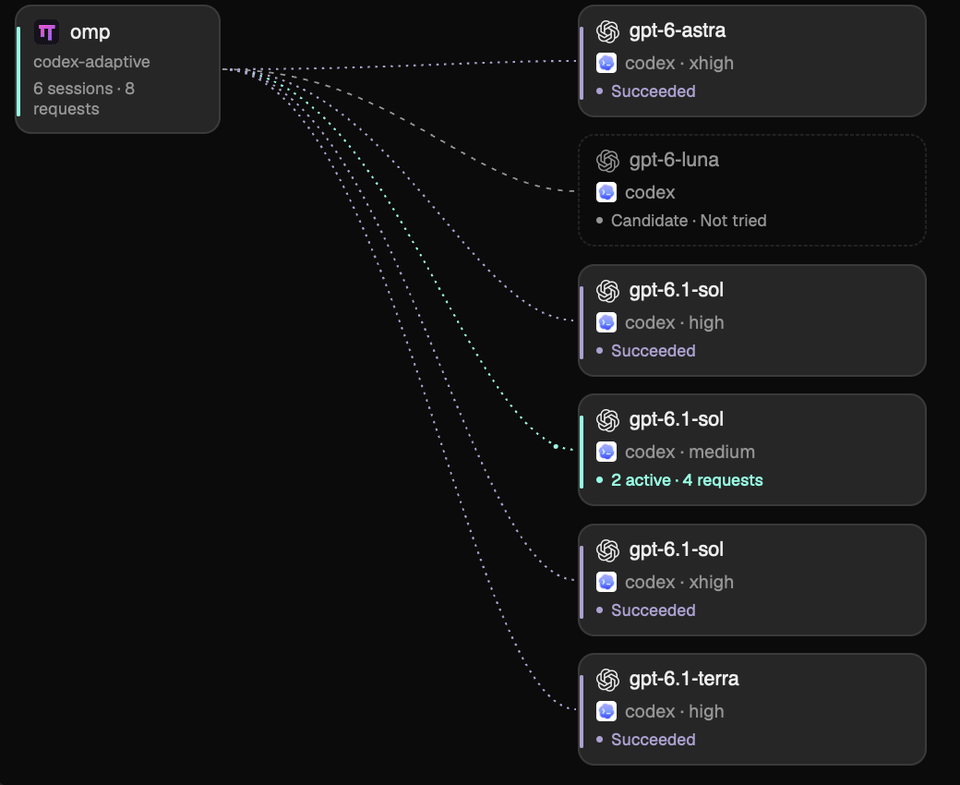

# Herdr Magpie Route

用于 [Herdr](https://herdr.dev) 的原生侧栏插件，展示 [Magpie](https://github.com/yetone/magpie) 的模型路由、请求尝试过程和账户额度。

[English](README.md) · [重建说明](RECIPE.md)



录制自真实网关请求，可看到活动路径上的流动光点，以及候选、已完成分支的不同状态。[完整侧栏截图](preview.png)。会话标识已脱敏。

## 功能

- 查看当前本机 OMP 会话，或浏览网关保留的全部近期请求。
- 直接显示实际模型、effort、候选分支和原生流动动画。
- 独立“用量与费用”页按模型展示输入、输出、缓存 token 与美元预估费用，可切换当前会话和全部网关用量。
- 展示整体和每个模型的输入缓存命中率，基于 Magpie 全部已记录用量，统一保留两位小数。
- 最近请求上方提供紧凑的 classifier 折叠区，展开查看模型、意图、难度、置信度、耗时与决策复用。
- 点击请求展开尝试与候选详情；最近请求默认三条，展开后每页五条。
- 展示全局账户额度、余额或剩余比例、重置时间与缓存读数。
- 分别使用模型系列和上游 Provider 的图标。
- 默认英文，支持简体中文切换并记住选择；界面、提示、无障碍标签和日期/数字格式同步切换。
- 默认隐藏账户身份，支持关闭动画。

## 环境要求

已在 macOS、Herdr App **0.1.15** 验证。需要运行中的本机 Magpie 网关，且支持 trace、usage 与 quotas 接口。当前会话关联还需要 OMP、Python 3、hc 和 lsof。Python 部分仅使用标准库，不需要安装第三方依赖。

尚未验证 Linux；当前 Unix 进程与文件发现逻辑不支持 Windows 会话关联。无法关联 OMP 时仍可使用“全部请求”。这不是 npm 包或浏览器扩展。

## 安装与接入

按 [英文安装步骤](README.md#install) 克隆仓库，将 `mods/magpie-route` 复制到 Herdr App home 的 `mods/` 下。默认 App home 为 `~/.config/herdr-app`，也支持 `HERDR_APP_HOME`。

安装前检查同名目录；已有版本先备份，不要直接覆盖。随后在**个人布局**中，将以下 block 放到终端旁的横向 row：

```json
{
  "id": "magpie-route-panel",
  "type": "block",
  "content": { "mod": "magpie-route" },
  "size": { "px": 420 },
  "min": 340,
  "max": 680,
  "padding": 6
}
```

保持目录名 `magpie-route` 和节点 ID `magpie-route-panel`；插件依赖它们定位资源和判断显隐。manifest 为 `place: none`，仅复制文件不会自动停靠。修改官方布局前先克隆，不要修改 Herdr 自带文件。

用 `herdr-app check` 检查安装目录；命令不在 PATH 时，使用 Herdr.app 内的可执行文件和相同参数。个人 mod 支持热加载，无需重启。RECIPE.md 和 preview.png 留在仓库，不复制到安装目录。

## 使用

英文界面点击 **中文** 切换为简体中文，中文界面点击 **EN** 切回英文。语言只影响此插件，不改变筛选、分页和当前请求选择。

顶部“路由 / 用量与费用”页签共用当前会话/全部范围选择，并记住所选页面。两页的连接状态和“刷新”始终保留在标题栏同一位置，读取用量时也不会消失。用量页读取持久化网关调用账本，每 30 秒或手动刷新，按 provider/model 汇总全部模型，不受路由模型筛选影响。总 token 为 `input + output + cache_read + cache_write`；推理 token 已包含在输出中，不重复相加。转交后的尝试会计入 token 与费用，但不重复增加请求次数。Token 和调用次数使用 K/M/B/T 十进制简写，汇总、模型与缓存的悬停明细也使用相同简写。

费用按 Magpie 计价信息估算，以美元紧凑显示：常规金额保留到美分，小于一美分时保留四位小数，大额使用 K/M/B/T，不代表实际订阅或提供方结算账单。没有价格时显示未知；部分记录未定价时明确标注已知部分与未定价数量。当前会话严格匹配已关联的 session，遍历全部分页后在本地精确过滤；读取中分页总数变化时提示刷新，避免重复计数。全部用量仅统计经过 Magpie 网关的调用，不包含导入的历史直连记录或客户端上报调用。没有记录时显示暂无数据，不据此推断零费用；进行中调用在用量记录后更新。

点击“排序”进入当前页的紧凑排序列表，抓住点状手柄拖动，插入线标出落点，松手保存；按 Esc 或移出列表取消本次拖动。也可使用上移/下移按钮或手柄上的方向键。“完成”返回数据页。路由和用量分别保存顺序，重启后保留；“恢复默认”只重置当前页。

打开模型筛选下拉菜单可直接选择“全部模型”或任意当前可用路由组（如 `codex-gemini-adaptive`、`codex-adaptive` 等）。当前会话与模型筛选不影响下方全局账户额度。自动读取使用网关缓存；“刷新额度”会明确请求网关更新提供方读数。未知额度不会显示成已用 0%。

最近请求默认只显示三条；展开后每页五条，可以上一页、下一页或收起。筛选变化重置页码；浏览全部请求时，切换终端标签页不重置全局历史页码。

输入缓存统计读取 `usage?period=all`，每 30 秒或手动刷新，覆盖 Magpie 已记录用量日志，包括客户端上报与 classifier 调用，不受会话或模型筛选影响。整体命中率按 token 加权：`cache_read / (input + cache_read + cache_write - cache_unknown)`。模型卡片使用同一日志按 provider/model 聚合，包含各 effort 和账户。缓存状态未知的输入不计入分母；没有可统计 token 或读数不可用时显示“未上报”。命中率保留两位小数，已知的零和满命中分别显示 `0.00%`、`100.00%`。

Classifier 区域位于账户额度下方、最近请求上方，默认折叠。选中请求时展示该请求的 classifier；未选中时展示当前路由筛选范围内最近一次上报的分类，展开后查看完整字段。上一轮意图和 effort 是分类上下文，父级 effort 表示继承上层路由选择；决策复用与输入 token 缓存命中分别标注。缺失值保持未知，不保留 classifier 原始错误文本。

## 数据访问与隐私

- 读取 `~/.config/magpie/settings.json` 的 port 字段，缺省为 3425。
- 访问 127.0.0.1 上的 Magpie `/v1/models`、`trace`、`usage?period=all`、`usage/requests?period=all&via=through`（会话查询附带 `q`，并完整分页后精确匹配）和 `quotas?kept=1` 接口；手动刷新额度会调用 `quotas/refresh`。
- 调用 python3、hc get --json、lsof；仅从前台 OMP 进程打开的文件中确认根会话，不按目录、模型或最近修改时间猜测。
- 对 `~/.omp/agent/sessions` 下的候选文件，最多读取前 16 KiB / 四行，不扫描完整对话。
- 默认隐藏账户身份，仅保留侧栏所需的路由字段。上游原始提示保留原语言。
- 用量响应立即收窄为整体/模型计数与记录起始时间，不保留其中的会话、账户、Key 和文件路径字段。
- 费用页逐页收窄为 token 与价格计数，仅用关联会话做本地精确匹配，不在界面状态中保留原始账本行、账户/Key 元数据或响应 ID。

列表反映网关近期缓存，不是完整会话档案。运行时没有遥测或外部图标下载。仓库不包含个人布局、设置、凭据或会话文件；预览图已经脱敏。

## 许可

MIT。上游图标来源、许可全文及商标说明见 [THIRD_PARTY_NOTICES.md](THIRD_PARTY_NOTICES.md)。这是独立社区插件。
