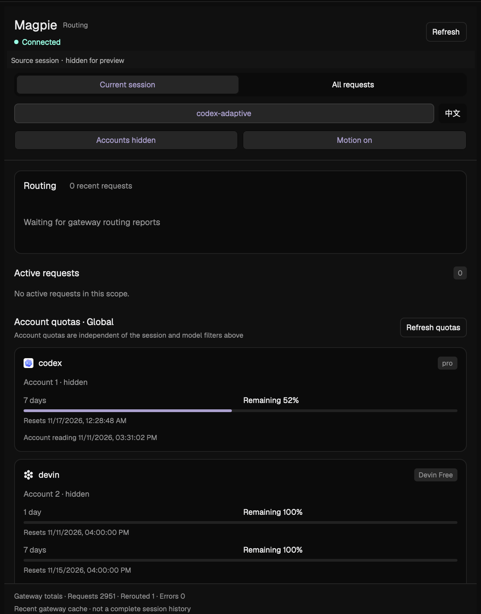

# Herdr Magpie Route

用于 [Herdr](https://herdr.dev) 的原生侧栏插件，展示 [Magpie](https://github.com/yetone/magpie) 的模型路由、请求尝试过程和账户额度。

[English](README.md) · [重建说明](RECIPE.md)



## 功能

- 查看当前本机 OMP 会话，或浏览网关保留的全部近期请求。
- 直接显示实际模型、effort、候选分支和原生流动动画。
- 点击请求展开尝试与候选详情；最近请求默认三条，展开后每页五条。
- 展示全局账户额度、余额或剩余比例、重置时间与缓存读数。
- 分别使用模型系列和上游 Provider 的图标。
- 默认英文，支持简体中文切换并记住选择；界面、提示、无障碍标签和日期/数字格式同步切换。
- 默认隐藏账户身份，支持关闭动画。

## 环境要求

已在 macOS、Herdr App **0.1.15** 验证。需要运行中的本机 Magpie 网关，且支持 trace 与 quotas 接口。当前会话关联还需要 OMP、Python 3、hc 和 lsof。Python 部分仅使用标准库，不需要安装第三方依赖。

尚未验证 Linux；当前 Unix 进程与文件发现逻辑不支持 Windows 会话关联。无法关联 OMP 时仍可使用“全部请求”。这不是 npm 包或浏览器扩展。

## 安装与接入

按 [英文安装步骤](README.md#install) 克隆仓库，将 `mods/magpie-route` 复制到 Herdr App home 的 `mods/` 下。默认 App home 为 `~/.config/herdr-app`，也支持 `HERDR_APP_HOME`。

安装前检查同名目录；已有版本先备份，不要直接覆盖。随后在**个人布局**中，将以下 block 放到终端旁的横向 row：

```json
{
  "id": "magpie-route-panel",
  "type": "block",
  "content": { "mod": "magpie-route" },
  "size": { "px": 420 },
  "min": 340,
  "max": 680,
  "padding": 6
}
```

保持目录名 `magpie-route` 和节点 ID `magpie-route-panel`；插件依赖它们定位资源和判断显隐。manifest 为 `place: none`，仅复制文件不会自动停靠。修改官方布局前先克隆，不要修改 Herdr 自带文件。

用 `herdr-app check` 检查安装目录；命令不在 PATH 时，使用 Herdr.app 内的可执行文件和相同参数。个人 mod 支持热加载，无需重启。RECIPE.md 和 preview.png 留在仓库，不复制到安装目录。

## 使用

英文界面点击 **中文** 切换为简体中文，中文界面点击 **EN** 切回英文。语言只影响此插件，不改变筛选、分页和当前请求选择。

如果网关没有 codex-adaptive 组，切换到“全部模型”。当前会话与模型筛选不影响下方全局账户额度。自动读取使用网关缓存；“刷新额度”会明确请求网关更新提供方读数。未知额度不会显示成已用 0%。

最近请求默认只显示三条；展开后每页五条，可以上一页、下一页或收起。筛选变化重置页码；浏览全部请求时，切换终端标签页不重置全局历史页码。

## 数据访问与隐私

- 读取 `~/.config/magpie/settings.json` 的 port 字段，缺省为 3425。
- 访问 127.0.0.1 上的 Magpie trace/quotas 接口；手动刷新额度会调用 quotas/refresh。
- 调用 python3、hc get --json、lsof；仅从前台 OMP 进程打开的文件中确认根会话，不按目录、模型或最近修改时间猜测。
- 对 `~/.omp/agent/sessions` 下的候选文件，最多读取前 16 KiB / 四行，不扫描完整对话。
- 默认隐藏账户身份，仅保留侧栏所需的路由字段。上游原始提示保留原语言。

列表反映网关近期缓存，不是完整会话档案。运行时没有遥测或外部图标下载。仓库不包含个人布局、设置、凭据或会话文件；预览图已经脱敏。

## 许可

MIT。上游图标来源、许可全文及商标说明见 [THIRD_PARTY_NOTICES.md](THIRD_PARTY_NOTICES.md)。这是独立社区插件。
