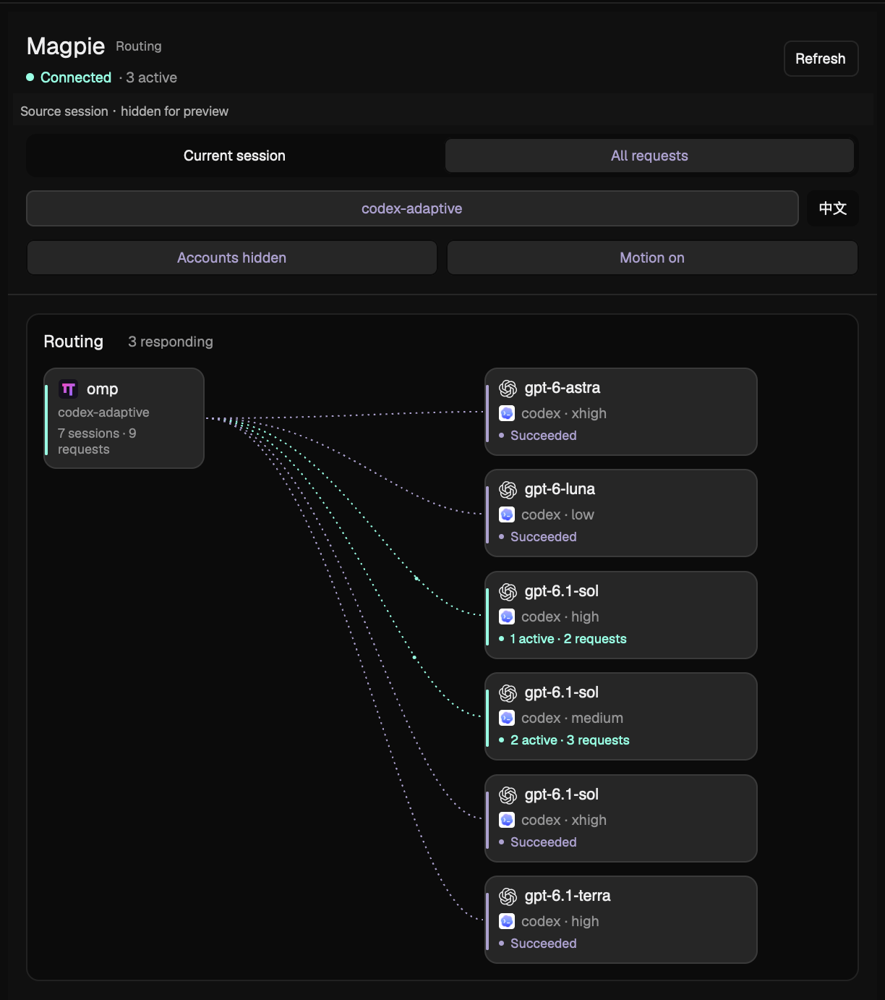

# Herdr Magpie Route

A native right sidebar that shows where a local OMP request goes through Magpie, the model that actually answers, and global account quotas. English is the default, with an explicit Simplified Chinese switch.

## What you see

A resizable 420px sidebar, minimum 340px and maximum 680px. Surface and text follow the host theme. Use a quiet 10px radius, thin theme borders, 14px outer insets and 18px section gaps. The title is 18px; section headings 13px, model/body text 12px, metadata 11px and captions 10px.

Top to bottom:

1. Magpie title, connection state, refresh and the shortened source session.
2. Routing / Usage & cost page segments, then shared current-session/all scope, language and account-identity controls; model filter and motion controls appear on Routing only.
3. A compact global input-cache card: two-decimal weighted hit rate, cache-read/eligible tokens, excluded unknown tokens, recording start and manual refresh.
4. A routing card: OMP sources on the left and individual model/effort destinations on the right, each with its global provider/model cache hit rate. Keep at least 24px between node columns after subtracting layout/card padding at the minimum width. Do not insert a central gateway box.
5. Live request rows, expandable per-request details and attempt/candidate records.
6. Global provider quota cards, cached reading/reset timestamps and explicit refresh.
7. A compact classifier section, collapsed by default; Expand/Collapse reveals full metadata for the exact selected request or the latest classification in the current filtered scope.
8. Three recent request rows by default, with expand/collapse and five rows per page when expanded.
9. A compact footer with global request/reroute/error totals and the cache-history limit.

Model-family and provider icons are independent. A GPT model routed through another provider keeps its OpenAI model mark and the provider's own mark. Unknown families retain their text without a fabricated brand. Single-color marks use theme-tinted native SVG masks; colored marks keep their source colors.

Usage & cost is a separate native scroll page: a scoped total-token/USD-estimate summary, pricing-coverage note, and all provider/model cards sorted by token use. Show input/output and cache-read/write counts; reasoning is included in output. Use two-column metric rows that fit 340px, compact K/M/B/T token/call counts and USD amounts, and exact-value tooltips on summary/model cards. Normal USD amounts keep cents and sub-cent estimates retain four decimals. Explicitly show missing/partial pricing and no-data states. Never present estimates as actual charges. Switching pages preserves scope; changing session or scope clears obsolete amounts before the next read.

## How it behaves

A live request has an active destination and native moving points along its observed path. Candidate-only routes are dashed and do not animate. Success, failure, cancellation and ended/continued attempts have distinct text labels as well as theme-derived colors. These are gateway request states; do not infer them from the terminal agent's working/idle status.

Clicking a request toggles details and pins its observed route. Scope/model changes clear the old selection and reset recent-history pagination. Changing the terminal tab resets session-scoped browsing; global pagination stays on the same page. Clamp pages when the retained cache shrinks. Live requests are not paginated.

The English/Chinese toggle is persisted with localStorage and updates existing diagnostic descriptors without changing filters, selection or pagination. Translate labels, tooltips, accessibility text, privacy markers, plural counts and date/number formatting. Keep model/provider identifiers and raw upstream data unchanged.

Refresh restarts stream reading and session binding. Automatic quota reads use cached gateway results; explicit quota refresh can contact upstream providers through Magpie. Disable refresh controls while their corresponding operation is busy. Keep hover, press, selected and keyboard-focus states visible without moving layout bounds.

Read global cache metrics from `usage?period=all` every 30 seconds or on explicit refresh; use `cache_read / (input + cache_read + cache_write - cache_unknown)` and keep two decimal places. The overall and provider/model metrics cover the recorded Magpie usage log, including client-reported and classifier calls, independently of routing filters, efforts and seats. Exclude unknown cache input; unavailable or zero-denominator rates stay unknown. Discard ledger identities and paths immediately after narrowing the response.

The classifier section sits after quotas and before recent requests. Keep its default collapsed summary short, with an explicit Expand/Collapse control and request/time context; never substitute another request's classifier for a selected request that has none. Metadata comes only from `rule.classified`: model, available/chosen intent, current effort, difficulty 0–3, confidence, latency, same-message decision reuse, previous intent/effort, parent-group effort and fallback policy. Missing fields stay unknown. Keep raw classifier errors out of view state and distinguish decision reuse from token caching.

Accounting uses `usage/requests?period=all&via=through` for both scopes: All reads server totals and provider/model shares, while Session uses encoded `q` plus exact session equality across every offset page. Reject changed totals rather than returning an incomplete or double-counted read. Count tokens/cost from handed-on attempts without adding a call; exclude local rejections. Preserve priced zero, distinguish unavailable/partially priced estimates, and do not add imported direct-session history or reported calls. Guard asynchronous results by session, scope and view generations; never show a previous session's amount under a new session.

When the gateway is offline, disclose cached/stale results. When session binding is unavailable, explain why and retain all-request browsing. Empty, missing, text-only, unlimited and failed quotas remain distinct; never invent 0% usage. Account identities start hidden. Motion can be disabled.

## Built from

Distribution tree: `mods/magpie-route/` contains `main.js`, `route-view.js`, `routing-graph.js`, `routing-data.js`, `usage-format.js`, `i18n.js`, `locales/`, `resolve-session.py`, `brand-icons.js`, `icons/`, `omp.svg` and `mod.json`.

Place a block with ID `magpie-route-panel` and `content.mod: magpie-route` beside the active terminal area in a user-owned horizontal layout row. The manifest is focusable and has `place: none`. The mod reads no pane props.

Herdr APIs: View, native div/flex/Button/Progress primitives, focus handles, timers and spawned work; layout/spaces/panes/terminals/focused; home/appHome/readTextFile/exec/nextCommand/theme. Graph curves use PathBuilder/window.paint_path and native frame animation. No DOM, browser engine, Node APIs or runtime npm dependencies are involved.

Data comes from Magpie's loopback trace, usage and quota endpoints. The Python standard-library resolver invokes hc and lsof, confirms foreground process identity twice and accepts only a uniquely open root OMP session. It reads bounded leading metadata rather than whole conversations. See README for exact commands, paths and privacy behavior.

Artwork: pinned Magpie brand SVGs with upstream MIT notice; an original geometric OMP pi marker. See THIRD_PARTY_NOTICES.md.

## Watch out

- Verified with Herdr App 0.1.15 on macOS. Do not claim Windows support or an unverified minimum Magpie version.
- Keep both the folder name magpie-route and layout node ID magpie-route-panel, or update helper/asset paths and visibility detection together.
- Default model filtering targets codex-adaptive; allow switching to all models.
- Session identity is local and exact. Never guess it from directory, model, account, session age or tab title; refuse remote/ambiguous sources.
- Gateway cache retention is authoritative. Do not truncate active routes to a guessed fixed row limit.
- Do not add the trace wait query: any nonempty value can hold the server call for 25 seconds.
- Idle/candidate/finished edges do not move. Keep native motion independent of polling and share path/frame resources per view.
- English text is often longer than Chinese. Compute node heights from wrapped localized text and preserve model legibility at 340px.
- Do not redistribute settings, credentials, sessions, generated host SDK files or personal layouts. Redact any preview capture.

## Done when

- Herdr's mod check passes and the block appears in a personal layout.
- Current-session filtering matches the foreground local OMP session exactly; all-request browsing works when binding is unavailable.
- Observed live paths animate; candidates and completed paths do not.
- Model/provider marks remain distinct and legible in the host theme.
- Recent preview, expansion, page bounds, shrink-clamping and filter resets work.
- Both language catalogs have matching keys/placeholders, existing notices switch language, and 340px/680px layouts show complete controls and model identities.
- Quotas remain global, unknown values stay unknown, and private identities stay masked by default.
- Global/model cache rates agree with the Usage ledger, retain two decimals, exclude unknown cache input and remain independent of routing filters.
- Classifier fields retain their reported semantics; previous-turn context, inherited effort and decision reuse are labeled explicitly.
- Usage & cost switches exact-session/all gateway accounting without stale amounts, shows full model token totals and honest USD pricing coverage, and keeps routing cache/quotas semantics separate.
